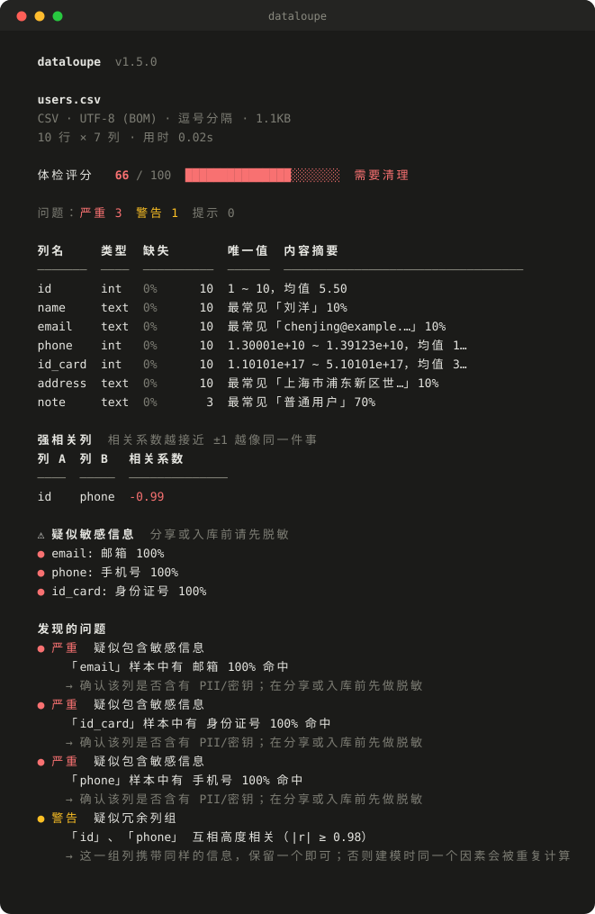

# dataloupe · 数据放大镜

**一条命令，看清任何数据文件。** 零依赖，零配置，一个文件。

[](https://github.com/lilikk888/dataloupe/actions/workflows/tests.yml)
[](https://www.python.org/)
[](#)
[](LICENSE)



给它一个 CSV / TSV / JSONL / JSON / XLSX，它告诉你里面到底是什么：编码、
分隔符、每列实际存了什么，以及**这份数据哪里有问题**。

```bash
python dataloupe.py sales.csv
```

```
  dataloupe  v1.1.0

  messy.csv
  CSV · UTF-8 · 逗号分隔 · 4.1KB
  67 行 × 8 列 · 用时 0.02s

  体检评分   54 / 100  ████████████░░░░░░░░░░  需要清理

  问题：严重 4  警告 3  提示 2

  列名      类型   缺失  唯一值  内容摘要
  ────────  ─────  ────  ──────  ────────────────────────────
  id        int      0%      61  2000 ~ 2999，均值 2,041.55
  客户名称  text     0%       6  最常见「赵六」27%
  金额      float   22%      44  100 ~ 8999.79，均值 3,719.03
  日期      date    12%      50  2024-01-12 ~ 2024-12-22
  状态      text     0%       3  最常见「处理中」37%
  列7       empty  100%       0  （无数据）

  发现的问题
  ● 严重  列名重复
      「状态」出现了 2 次，读取时后一列会覆盖前一列
      → 重命名后重新导出，否则按列名取值只会拿到其中一列
  ● 警告  存在重复行
      6 行（9.0%）与其他行完全相同
      → 去重前先确认重复是采集错误还是业务上本就允许
```

加 `-o report.html` 会生成一份**单文件网页报告**：带图表、列卡片、按严重度
排序的修复建议。不需要服务器，不联网也能看。

---

## 为什么还要再造一个轮子

`pandas-profiling` / `ydata-profiling`、`sweetviz` 都是好工具。但为了回答
「这个 CSV 干净吗」，它们要拉上 pandas、numpy、matplotlib 和几十个间接依赖
——几百 MB。

`dataloupe` 是**一个文件，只用标准库**。

| | ydata-profiling / sweetviz | **dataloupe** |
|---|---|---|
| 安装 | `pip install` + pandas/numpy/matplotlib | **复制一个文件** |
| 依赖 | 几十个 | **零** |
| 启动 | 好几秒 | 约 0.1 秒 |
| 内存 | 随行数线性增长 | **恒定 76 MB**（5 万行到 500 万行都是） |
| 50 万行 × 8 列 | 分钟级 | **4.8 秒**（实测） |
| GBK / GB18030 输入 | 经常直接崩 | 自动识别 |
| 读 .xlsx | 要装 openpyxl | 内置（zip + xml） |
| 输出 | 重 | 单文件 HTML，离线可用 |

它不是完整的 profiling 库的替代品。它是你**刚拿到一个文件、还没开始写分析
代码时**，先看一眼「这东西能不能用」的工具。

---

## 快速开始

```bash
# 终端摘要
python dataloupe.py data.csv

# 顺便生成一份网页报告
python dataloupe.py data.csv -o report.html

# 给脚本/CI 用的 JSON
python dataloupe.py data.csv --json

# 顺便看看前几行长什么样
python dataloupe.py data.csv --preview

# 超大文件只抽样
python dataloupe.py huge.csv --limit 100000

# 直接生成建表语句
python dataloupe.py data.csv --sql postgres

# 修好数据另存一份（原文件不动）
python dataloupe.py data.csv --fix
```

退出码可以直接当 CI 门禁：

| 退出码 | 含义 |
|---|---|
| `0` | 没有严重问题（且评分达到 `--fail-under`） |
| `1` | 有严重问题，或评分低于 `--fail-under` |
| `2` | 文件不存在或读不了 |

`--json` 也遵守这套退出码，所以 CI 里直接拿它当门禁：

```yaml
# 只要有严重问题就构建失败
- run: python dataloupe.py data/export.csv --json

# 或者按分数卡线：低于 85 分就失败
- run: python dataloupe.py data/export.csv --fail-under 85
```

---

## 清洗数据

诊断只是一半，`--fix` 直接写出一份修好的副本，**原文件一个字节都不动**。

```bash
python dataloupe.py dirty.csv --fix
# -> dirty.cleaned.csv

python dataloupe.py dirty.csv --fix -o clean.csv --dedupe --drop-empty-cols
```

```
  已清洗 → dirty.cleaned.csv

  修正 51 个单元格（空格 39、全角 4）
  删除 6 行重复
  删除 1 个空列
  修正 2 个列名（空名或重名）
  写出 61 行 × 7 列
```

拿仓库里的 `examples/messy.csv` 试，分数从 **46 提到 91**——剩下的差距是缺失数据，
那不该由工具替你编。

| 修复项 | 默认 | 需要加参数 |
|---|---|---|
| 去首尾空格 | ✓ | |
| 全角转半角（`１２３` → `123`） | ✓ | |
| 去不可见控制字符 | ✓ | |
| `NA` / `null` / `-` 统一成空 | ✓ | |
| 空列名、重复列名 | ✓ | `--keep-headers` 可关闭 |
| 删除重复行 | | `--dedupe` |
| 删除整列为空 | | `--drop-empty-cols` |

输出默认是 **带 BOM 的 UTF-8**，Excel 双击打开不会乱码。要接管道处理就加 `--no-bom`。

它**从不猜**：不填充缺失值、不凭空造行、看着像数字的文本也原样保留。

---

## 建表语句

推断出来的类型可以直接变成 DDL，省掉「先看数据、再手写 CREATE TABLE」那一步。

```bash
python dataloupe.py sales.csv --sql postgres
```

```sql
-- dataloupe 1.1.0 · sales.csv · 240 rows × 8 columns
CREATE TABLE sales (
    order_id    BIGINT,
    order_date  DATE,
    product     TEXT,
    category    TEXT,
    quantity    BIGINT,
    unit_price  DOUBLE PRECISION,
    customer    TEXT,
    region      TEXT
);
```

支持 `postgres` / `mysql` / `sqlite`。方言差异按各家的规矩处理：

| | postgres | mysql | sqlite |
|---|---|---|---|
| 整数 | `BIGINT` | `BIGINT` | `INTEGER` |
| 小数 | `DOUBLE PRECISION` | `DOUBLE` | `REAL` |
| 布尔 | `BOOLEAN` | `TINYINT(1)` | `INTEGER` |
| 日期 | `DATE` / `TIMESTAMP` | `DATE` / `DATETIME` | `TEXT` |

带时间的日期会自动升成 `TIMESTAMP`。列名不是纯小写标识符（`Order`、`客户名称`、
`user` 这种关键字）会自动加引号，MySQL 用反引号。表名默认取文件名，
`--table events` 可以改。

---

## 相关性

每两个数值列之间都会算 Pearson 相关系数。|r| ≥ 0.5 的列出来；|r| ≥ 0.98 的
直接判定为**冗余列**——同一个信号存两份，训练模型时会被重复计算权重，结果会歪。

```
  强相关列  相关系数越接近 ±1 越像同一件事
  列 A      列 B       相关系数
  ────────  ─────────  ────────
  price     price_cny     +1.00
  area_sqm  price         +1.00
```

三列互相高度相关时只报**一条**，不是三条——先用并查集把相关的列并成组再报告。

---

## 它检查什么

**解析层**
- 编码：UTF-8、UTF-8 带 BOM、UTF-16、GB18030、GBK、Big5、CP1252
- 分隔符：逗号、制表符、分号、竖线——按「每行切出来的列数是否一致」判断
- 行列数不一致的行（字段数与表头不符）
- 重复列名、空列名
- **仅大小写不同的列名**（`id` 和 `ID`——SQL Server、Excel、多数 ORM 不区分大小写）
- **CSV 注入**：以 `=` `+` `-` `@` 开头的值，在 Excel / WPS 里会被当公式执行
  （`=cmd|'/C calc'!A0` 是经典载荷），而纯数字 `-5` 不会误报

**列类型**
`int` · `float` · `bool` · `date` · `text` · `empty`，用 95% 容忍度推断，
几个脏值不会把数值列误判成文本。

**质量问题**
- 每列缺失率
- 完全重复的行
- 类型混杂（有多少值不符合推断出的类型）
- 首尾多余空格
- 全角 ASCII（`１２３`、`ＡＢＣ`）——肉眼看着一样，程序直接算错
- 不可见控制字符
- 常量列、几乎每行都不同的 ID 列、自增序号列
- 1.5 × IQR 离群值
- **同一列里日期格式混用**（`2024-01-05` 和 `05/01/2024` 混着）
- **有歧义的日期**（日和月都 ≤ 12，任何工具都无法判断哪个是月）
- 数值分布、均值/中位数/标准差、直方图

每条问题都带**修复建议**——光说「X 列 43% 缺失」没法行动。

---

## 支持的格式

| 格式 | 扩展名 | 说明 |
|---|---|---|
| CSV | `.csv` `.txt` | 分隔符自动识别 |
| TSV | `.tsv` | |
| JSON Lines | `.jsonl` `.ndjson` | 各记录的键取并集 |
| JSON | `.json` | 对象数组，或 `{"data": [...]}` |
| Excel | `.xlsx` `.xlsm` | 第一个工作表，含共享字符串、日期样式 |

**不支持 `.xls`**（老的二进制格式，是完全不同的容器）。请另存为 `.xlsx` 或 CSV。

---

## 评分怎么算

100 分起扣：

| 严重度 | 扣分 | 例子 |
|---|---|---|
| 严重 | −10 | 空列、列名重复、行列数不一致、缺失超过 50% |
| 警告 | −4 | 重复行、类型混杂、缺失 20~50%、不可见字符 |
| 提示 | −1 | 多余空格、全角字符、常量列、离群值 |

它是个粗略信号，不是考试分数。70 分带三条提示的文件通常没问题；
60 分但有一列全空的文件，问题很大。

---

## 安装

不用装：

```bash
python dataloupe.py data.csv
```

需要 Python 3.8+，别的什么都不用。

想在命令行里直接敲 `dataloupe`：

```bash
pip install .
dataloupe data.csv
```

---

## 性能与内存

Windows / Python 3.13，8 列混合类型（整数、日期、文本、浮点、布尔）实测：

| 行数 | 文件大小 | 用时 | 内存峰值 |
|---|---|---|---|
| 50,000 | 2.6 MB | 0.6 s | 47 MB |
| 500,000 | 26 MB | 4.8 s | 76 MB |
| 2,000,000 | 102 MB | 16.8 s | 76 MB |
| 5,000,000 | 257 MB | 39.4 s | 76 MB |

**文件大了 100 倍，内存一动不动。** 这是 `dataloupe` 和大多数 profiling 工具
最大的区别：它不把文件读进内存，而是一行一行喂给每列的累加器，喂完就丢。

```python
for row in rows:              # 一次只持有一行
    for acc, cell in zip(accumulators, row):
        acc.add(cell)
```

每个累加器只保留有上限的结构，所以内存由**列数**决定，和行数无关：

| 保留的东西 | 上限 |
|---|---|
| 不同值计数表 | 10 万个不同值（超过就报 `≥100,000`） |
| 数值抽样 | 20 万个浮点（蓄水池抽样，算法 L） |
| 类型判定样本 | 前 2000 个非空值 |
| 卫生检查样本 | 前 5000 个值 |
| 重复行指纹 | 前 20 万个不同行 |

代价是：**超过 20 万个数值时，中位数、四分位数和直方图来自随机抽样**，
报告里会标 `*` 并说明。最小值、最大值、均值、标准差、缺失数**任何规模都是精确的**
（均值/方差用 Welford 递推，不是先存再算）。

三个关键优化：

1. **ISO 日期快路径** —— `datetime.strptime` 每次调用都要编译正则、碰 locale。
   解析 50 万个日期要 14 秒；改成「一条正则 + 直接构造 datetime」后不到 1 秒。
2. **蓄水池用算法 L** —— 朴素抽样每行调一次随机数，1000 万行要好几秒；
   算法 L 按几何分布跳着抽，随机数只调几十万次。
3. **卫生检查抽样** —— 多余空格、全角字符、控制字符都是低频问题，
   只查前 5000 个值，不查全部单元格。

> `--fix` 是例外：它要重写整张表，所以仍然全量载入。超大文件请先用
> `--limit` 看一眼，再决定要不要清洗。

---

## 测试

```bash
python -m unittest discover -s tests -v
```

131 个测试，覆盖编码识别、分隔符嗅探、类型推断、统计正确性、相关性、
流式累加器与一次性计算的一致性、蓄水池抽样精度、相关系数的行对齐、流式与全量载入的内存对比、CSV 注入识别、建表语句生成、退出码与 CI 门禁、质量检测、数据清洗、
xlsx 解析、HTML 转义、CLI 退出码。

```
Ran 131 tests in 7.21s

OK
```

---

## 许可证

MIT
